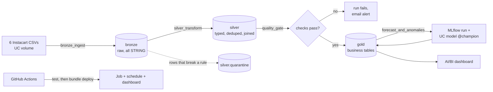

# DemandIQ on Databricks

The DemandIQ pipeline rebuilt as a lakehouse: the 3.4M Instacart orders go
through **bronze, silver and gold Delta tables** in Unity Catalog, a
**data-quality gate** stops bad data before it reaches gold, a **scheduled
Databricks job** runs it every week, forecasts are tracked in **MLflow**,
and an **AI/BI (SQL) dashboard** sits on the gold layer. The job, schedule
and dashboard are code (a Declarative Automation Bundle, formerly called
Databricks Asset Bundle) and **GitHub Actions** tests and deploys it.

The local DuckDB + Streamlit version in the repo root is unchanged; this is
the same product on the stack data teams at larger companies use.



## Tables

| Layer | Tables | What happens |
|---|---|---|
| bronze (`demandiq_bronze`) | `orders_raw`, `order_products_prior_raw`, `order_products_train_raw`, `products_raw`, `aisles_raw`, `departments_raw` | The CSVs as they arrived, every column as STRING, plus `_source_file`, `_ingested_at`, `_run_id`. The header is checked against the expected columns, so a wrong or renamed file fails at load. |
| silver (`demandiq_silver`) | `departments`, `aisles`, `products`, `orders`, `order_lines`, `quarantine` | Typed with `try_cast`, de-duplicated on keys, joined (`order_lines` = item + order + product + department). Each order gets an estimated date (see below). A row that breaks a rule goes to `quarantine` with the reason and its raw values instead of being dropped. Delta CHECK constraints on `orders` and `order_lines` block bad writes if a code change ever lets one through. |
| gold (`demandiq_gold`) | `department_daily_demand`, `department_kpis`, `peak_order_hours`, `basket_size_by_dow`, `department_demand_by_hour`, `department_demand_by_dow`, `top_products_by_department`, `overview_kpis`, `forecast_eval`, `forecast_metrics`, `demand_anomalies`, `dq_check_results`, `dq_quarantine_summary` | The eight queries from `../sql/` as tables, the daily series the forecaster uses, forecast and anomaly outputs, and the quality-check history. |

The gold tables give the same answers as the original DuckDB SQL: the test
suite runs the eight `.sql` files unchanged through Spark and compares
(`tests/test_parity_with_sql.py`).

## Data quality

Two layers:

1. **Row level, in silver.** Missing keys, values that don't parse,
   out-of-range day/hour/gap, unknown `eval_set`, duplicate keys, order
   lines whose order or product doesn't exist: each goes to
   `silver.quarantine` with a reason such as `invalid_order_hour` or
   `orphan:product_id`.
2. **Table level, the `quality_gate` task.** Results are appended to
   `gold.dq_check_results` and shown on the dashboard. Any failed `error`
   check fails the task, so `gold_build` never runs on bad silver data and
   the job emails you.

| Check | Severity | Catches |
|---|---|---|
| `<entity>_reconciled_bronze_to_silver` | error | rows lost or invented between layers (silver + quarantine must equal bronze) |
| `<entity>_quarantine_rate_pct` (<= 0.1%) | error | a systemic problem: wrong file, changed export format |
| `orders_min_volume` (>= 3M) | error | a truncated or partial upload |
| `orders_order_id_unique`, `order_lines_key_unique` | error | duplicate keys |
| `order_lines_fully_enriched` | error | lines missing department, date or order attributes |
| `order_lines_split_matches_order` | error | prior/train files swapped at upload |
| `departments_count` = 21, `aisles_count` = 134 | warn | dataset version changes |
| `first_orders_have_no_gap`, `repeat_orders_have_gap`, `test_orders_have_no_lines` | warn | known properties of the Instacart export |
| `est_date_matches_order_dow_pct` | warn | how well the reconstructed calendar agrees with the recorded weekday |
| gold: `daily_demand_reconciled_to_silver`, `volume_share_sums_to_100`, `kpis_cover_all_departments`, `daily_demand_non_negative`, `top_products_rank_le_3` | error | aggregation bugs |

## Job, schedule, alerts

`resources/demandiq_job.yml`: five tasks on serverless compute,
`bronze_ingest -> silver_transform -> quality_gate -> gold_build ->
forecast_and_anomalies`, every Monday 06:00 Berlin time, one run at a time,
one retry on ingestion, a timeout on every task, and an email to you on
failure. Each run's id (`{{job.run_id}}`) is stamped on bronze rows,
quarantine rows and quality results, so any row can be traced to the run
that produced it.

## Forecasting with MLflow

`forecast_and_anomalies` trains one XGBoost model across all 21 departments
(lag, rolling and calendar features, as in `features.py`) and scores it on
the last 21 days against a seasonal-naive baseline (same weekday last week).
Each run logs parameters, overall and per-department MAE/RMSE/MAPE, feature
importance and the model to an MLflow experiment. If XGBoost beats the
baseline, the model is registered in Unity Catalog as
`workspace.demandiq_gold.demand_forecaster` with the alias `champion`. The
anomaly flags (LOW < 15% < MEDIUM < 25% < HIGH, same thresholds as
`anomaly.py`) use the champion's forecast.

This differs from the DuckDB version (separate Prophet vs XGBoost per
department) on purpose: one model is one artefact to track and register,
and the baseline answers whether the model is worth having at all.

## Dashboard

`dashboards/demandiq_lakehouse.lvdash.json`, four pages: **Overview** (KPI
counters, daily demand, department share, orders by hour), **Shopping
patterns** (reorder rate, basket size by day, weekday mix, reorder
interval, top products), **Forecast & anomalies** (forecast vs actual with
a department filter, latest-day anomalies, error by department) and **Data
quality** (latest checks, check history, quarantined rows). Every dataset
query is run against the test tables in CI.

## Estimated order dates

Instacart's public data has no calendar dates, only day of week, hour and
days since the customer's previous order. Each customer gets a
deterministic pseudo-random start day (hash of `user_id`), moved forward up
to six days so their first order falls on its recorded weekday, then their
real gaps are added up. Gaps and weekdays are measured; the calendar date
itself is an assumption. Because customers "arrive" over the first ~90
days and run out of history at the end, the forecaster only uses the
period where total demand is at least half its peak.

## Set it up (Databricks Free Edition, Windows)

1. **Account.** Sign up at Databricks Free Edition (free, no card). Copy
   your workspace URL from the browser, e.g.
   `https://dbc-xxxxxxxx-xxxx.cloud.databricks.com`.
2. **Token.** In the workspace: your avatar -> Settings -> Developer ->
   Access tokens -> Generate new token (90 days is fine). Keep it private.
3. **CLI.** In PowerShell:
   ```powershell
   winget install Databricks.DatabricksCLI
   databricks configure --host https://dbc-xxxxxxxx-xxxx.cloud.databricks.com
   # paste the token when asked
   ```
4. **Upload the data** (the six Kaggle CSVs; adjust the local folder):
   ```powershell
   databricks schemas create demandiq_landing workspace
   databricks volumes create workspace demandiq_landing raw MANAGED
   databricks fs cp "C:\path\to\instacart" dbfs:/Volumes/workspace/demandiq_landing/raw/instacart --recursive
   ```
   (Or Catalog -> workspace -> demandiq_landing -> raw -> Upload, into a
   folder called `instacart`.)
5. **Deploy and run**, from the `databricks` folder of the repo:
   ```powershell
   cd databricks
   databricks bundle validate -t prod
   databricks bundle deploy -t prod
   databricks bundle run -t prod demandiq_pipeline
   ```
   The last command streams the run and prints its URL. Expect the first
   run to take a while on the 33M order lines.
6. **Look at it.** `databricks bundle open -t prod demandiq_dashboard`
   opens the dashboard; Jobs & Pipelines shows the run graph; Experiments
   shows the MLflow run; Catalog shows the three schemas and the model.
   Take screenshots of the job graph, dashboard pages and MLflow run for
   the README.
7. **CI/CD.** In GitHub: Settings -> Secrets and variables -> Actions ->
   add `DATABRICKS_HOST` (workspace URL) and `DATABRICKS_TOKEN`. Every push
   to `master`/`main` that touches `databricks/` then tests the code and
   redeploys. Without the secrets the deploy step is skipped, not failed.

If `bundle validate` says the warehouse lookup failed, your SQL warehouse
has a different name: pass its id with
`--var="warehouse_id=<id>"` (SQL Warehouses -> the warehouse -> Overview).

Try changes on the `dev` target first (`-t dev`): tables go to
`demandiq_dev_*`, the job name gets a `[dev you]` prefix and its schedule
is paused.

## Run the tests locally

Needs Java 17+ and Python 3.11+.

```bash
cd databricks
pip install -r requirements-dev.txt
ruff check .
python -m pytest            # Parquet tables, ~1.5 min
DEMANDIQ_TEST_DELTA=1 python -m pytest     # real Delta tables (downloads the Delta jars)
DEMANDIQ_TEST_CONNECT=1 python -m pytest   # over Spark Connect, the way serverless runs it
```

CI runs the last two on every push.

The tests generate a small Instacart-shaped dataset (same files, columns
and quirks), run the whole job through `src/run_task.py`, then check: every
bronze row is accounted for, bad rows land in quarantine with the right
reason, the gate blocks a high quarantine rate and a truncated upload,
gold matches the original SQL, a re-run changes nothing, the forecast
outputs and MLflow run exist, and every dashboard query runs.

## Design decisions

- **Bronze keeps strings.** Typing at read time turns `"abc"` into NULL
  without a trace. Typing in silver with `try_cast` lets the bad value be
  quarantined with its raw text.
- **Quarantine instead of drop or fail.** One bad row shouldn't stop the
  pipeline, but it shouldn't vanish either. The gate turns "many bad rows"
  into a failure, because that usually means a wrong file, not noise.
- **Full refresh.** The source is a static snapshot, so each layer is
  rebuilt from the one below and a re-run is always safe. With a live
  feed this would become incremental (Auto Loader into bronze, `MERGE` into
  silver).
- **Gate between silver and gold.** Dashboards and models read gold, so
  that is the boundary worth protecting.
- **Weekly schedule.** The data doesn't change; weekly proves the
  automation without using up Free Edition's daily compute quota.
- **Tests on Parquet locally, Delta in CI.** The transformation code is
  identical; CI adds the Delta-only parts (CHECK constraints).

## Limitations

- Calendar dates are estimated (above). Day-of-week and gap patterns are
  real; trends over the "year" partly reflect the reconstruction.
- `order_dow` 0 = Sunday is a labelled guess; Instacart doesn't document it.
- Free Edition: serverless only, one small SQL warehouse, limited daily
  compute, no SLA. Fine for a portfolio, not for production.
- The job does not run the LangGraph agent or post to Slack; that stays in
  the local version.

## Results from the first full run

Fill this in from your own run (job output and dashboard), not from
estimates:

| | |
|---|---|
| Bronze rows (orders / order lines) | |
| Quarantined rows | |
| Checks passed / warnings | |
| `est_date_matches_order_dow_pct` | |
| XGBoost vs seasonal-naive RMSE (overall) | |
| Departments at HIGH on the latest day | |
| Job duration | |
